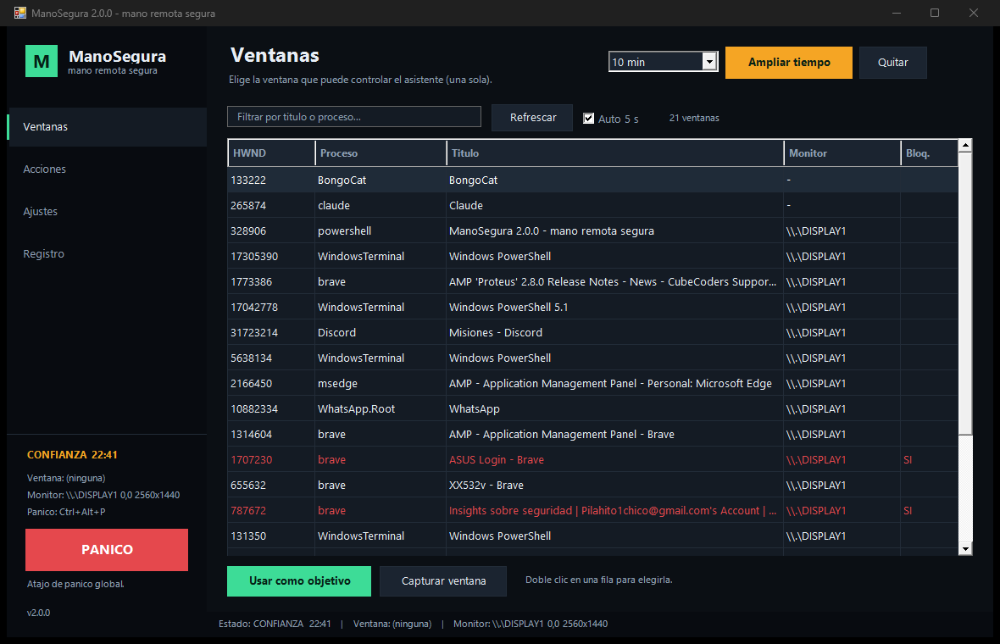

# ManoSegura 🖐️

**Mano remota segura para asistentes de IA en Windows.** Un asistente controla **una sola ventana** en **un monitor elegido**, con permiso, modo confianza temporal y tecla de pánico. Ahora con **interfaz gráfica**, **más opciones** y **menos trámites**.

PowerShell 5.1 o 7 · un solo archivo · sin descargas · sin admin · sin `-ExecutionPolicy Bypass`.

[](../../actions/workflows/tests.yml)



---

## Novedades de la 2.0

- **Interfaz gráfica** con tema oscuro: barra lateral, ventanas, acciones, ajustes y registro en una ventana. Se abre con `ui` o sin argumentos.
- **Más opciones**: `ConfirmMode` (preguntar o automático), confianza configurable, formato de captura, retardo de clic, límite de batch, lista de títulos bloqueados, atajo de pánico, líneas de registro.
- **Menos protocolo**: desaparecen el proceso vigilante obligatorio, la cadena de hashes de auditoría, el JSON de respuesta y las reglas especiales de navegadores. Queda lo importante: una ventana, un monitor, permiso, bloqueo de contraseñas/correo/pagos y pánico.
- **Comandos nuevos**: `ui`, `drag`, `focus` dentro de batch, `config set`, `--yes`, `--format png|jpg`.
- **Registro sencillo** (`logs/manosegura.log`) y capturas en `shots/` (con `latest.png`).

## Requisitos

- Windows 10/11.
- PowerShell 5.1 (incluido en Windows) o PowerShell 7.
- No hace falta administrador.
- Un monitor (o varios) y la ventana que quieras controlar.

## Instalación

1. Copia `ManoSegura.ps1` a una carpeta, por ejemplo `C:\Tools\ManoSegura\`.
2. Desbloquea el archivo (si vino de internet):
   ```powershell
   Unblock-File .\ManoSegura.ps1
   ```
3. Ejecuta con la política de ejecución por llamada o con `RemoteSigned` configurado:
   ```powershell
   powershell -NoProfile -ExecutionPolicy RemoteSigned -File .\ManoSegura.ps1
   ```
   No hace falta `Bypass`. Si usas un antivirus (Kaspersky, Defender…), añade una exclusión de la carpeta o del hash del script; **nunca** excluyas `powershell.exe` entero.

## Uso rápido

```powershell
# Abrir la interfaz gráfica
powershell -NoProfile -ExecutionPolicy RemoteSigned -File .\ManoSegura.ps1

# Ver ventanas y elegir una como objetivo
.\ManoSegura.ps1 list
.\ManoSegura.ps1 use "Bloc de notas"

# 10 minutos de confianza (sin diálogo en cada acción)
.\ManoSegura.ps1 trust 1h

# Acciones
.\ManoSegura.ps1 shot
.\ManoSegura.ps1 click 120 80
.\ManoSegura.ps1 type "Hola"
.\ManoSegura.ps1 key ctrl+s
.\ManoSegura.ps1 scroll -3
.\ManoSegura.ps1 drag 40 40 180 120

# Pánico y estado
.\ManoSegura.ps1 panic
.\ManoSegura.ps1 status
.\ManoSegura.ps1 enable
```

### Interfaz gráfica

| Pestaña | Qué hace |
|---|---|
| **Ventanas** | Lista las ventanas visibles (hwnd, proceso, título, monitor, si está bloqueada). Doble clic o *Usar como objetivo*. Filtro y auto-refresco cada 5 s. |
| **Acciones** | Clic, escribir, pegar, teclas, scroll, arrastre, espera y ejecutar un batch JSON. |
| **Ajustes** | Todos los ajustes de `config.json` con formulario; se guardan al momento. |
| **Registro** | Últimas líneas del registro y botón para abrir la carpeta. |

Arriba: estado (ventana, monitor, confianza), **PANICO**, **Activar** y el selector de confianza (**10 min**, **30 min**, **1 h**, **2 h**, **3 h** o **Personalizado...**). Si ya hay confianza activa, el botón cambia a **Ampliar tiempo** y **Quitar** la retira. Un borde naranja (rojo en confianza) marca la ventana controlada. El atajo de pánico (`Ctrl+Alt+P` por defecto) funciona mientras la interfaz está abierta.

## Tiempo de confianza

En la interfaz, elige **10 min**, **30 min**, **1 h**, **2 h**, **3 h** o **Personalizado...** y pulsa **Confiar**. Si ya hay confianza activa, el mismo botón pasa a **Ampliar tiempo** (suma minutos a la caducidad actual) y **Quitar** la desactiva. Por CLI:

```powershell
.\ManoSegura.ps1 trust 30m
.\ManoSegura.ps1 trust 2h
.\ManoSegura.ps1 trust add 30m     # o trust +30m
.\ManoSegura.ps1 trust 1h30m      # 90 minutos
.\ManoSegura.ps1 untrust
```

El máximo total lo pone `TrustMaxMinutes` en `config.json` (120 por defecto, hasta 1440). `status` muestra los minutos restantes.

## Comandos

| Comando | Descripción |
|---|---|
| `ui` | Abre la interfaz gráfica (también sin argumentos). |
| `list` | Lista ventanas visibles. |
| `use <hwnd\|titulo>` | Elige la ventana objetivo y la trae al frente. |
| `monitors` | Lista monitores y marca el objetivo. |
| `shot [ruta]` | Captura la ventana objetivo. |
| `shot --monitor <spec> [ruta]` | Captura un monitor. |
| `shot --hwnd <hwnd> [ruta]` | Captura otra ventana. |
| `click x y [left\|right\|double]` | Clic en coordenadas de la ventana. |
| `type "texto"` / `paste "texto"` | Escribe o pega. |
| `key ctrl+s` | Pulsa una combinación. |
| `scroll [pasos] [x y]` | Scroll (negativo = abajo). |
| `drag x1 y1 x2 y2` | Arrastra dentro de la ventana. |
| `wait [ms]` | Espera (máximo 10 s). |
| `batch <fichero.json\|->` | Varios pasos con un solo permiso. |
| `status` | Estado completo. |
| `trust [tiempo]` | Modo confianza: `10m`, `30m`, `1h`, `2h`, `3h`, `90`, `1h30m` (por defecto 10 min). |
| `trust add <tiempo>` / `trust +30m` | Añade tiempo a la confianza activa. |
| `untrust` | Quita el modo confianza. |
| `panic` / `enable` / `disable` | Desactiva o reactiva ManoSegura. |
| `config [show\|path\|reset]` | Muestra, abre o reinicia la configuración. |
| `config set <clave> <valor>` | Cambia un ajuste. |
| `check <titulo>` | Prueba las reglas de bloqueo. |
| `log [lineas]` | Últimas líneas del registro. |
| `version` / `help` | Versión y ayuda. |

Opciones globales:

- `--dry-run`: no toca ratón ni teclado; explica qué haría.
- `--yes`: no pide permiso (decisión tuya).
- `--format png|jpg`: formato de captura.

Códigos de salida: `0` correcto, `1` error, `2` cancelado o rechazado.

## Configuración (`config.json`)

| Clave | Por defecto | Para qué |
|---|---|---|
| `TargetMonitor` | `primary` | Monitor objetivo: `primary`, `1`, `left`, `right`, `x=-1920`, `DISPLAY2`. |
| `ConfirmMode` | `ask` | `ask` = pide permiso; `auto` = no pregunta. |
| `ConfirmTimeoutSec` | `20` | Segundos que espera el diálogo (5–300). |
| `TrustMaxMinutes` | `120` | Máximo del modo confianza (1–1440). |
| `ShotsDir` | `""` | Carpeta de capturas (vacío = `./shots`). |
| `ShotFormat` | `png` | `png` o `jpg`. |
| `ClickDelayMs` | `30` | Retardo antes del clic (0–1000). |
| `MaxBatchSteps` | `50` | Pasos máximos de un batch (1–200). |
| `Overlay` | `true` | Borde visible en la ventana objetivo. |
| `BlockSensitiveWindows` | `true` | Bloquea login, correo, pagos y banca. |
| `BlockedTitles` | `[]` | Títulos extra bloqueados (por ejemplo `["Mi banco"]`). |
| `PanicHotkey` | `Ctrl+Alt+P` | Atajo global de pánico (letras, números o F1–F12). |
| `LogLines` | `500` | Líneas que muestra el registro. |

Ejemplo en `config.example.json`. La configuración se valida al cargar: si algo no vale, se usa el valor por defecto y se avisa (en la GUI o con `status`).

## Seguridad y límites

- **Una ventana, un monitor**: la ventana debe estar entera en el monitor objetivo.
- **Nunca escribe en campos de contraseña** (comprobación de UI Automation).
- **Bloquea ventanas sensibles** (login, contraseñas, Gmail/Outlook, pagos, banca…). La lista es configurable y se puede desactivar con `BlockSensitiveWindows=false`.
- **Pánico**: `Ctrl+Alt+P` mientras la interfaz está abierta, o `panic` por CLI; desactiva ManoSegura y revoca la confianza. El estado persiste hasta `enable`.
- **Confianza con caducidad y ampliable**: presets de 10 min, 30 min, 1 h, 2 h, 3 h o tiempo personalizado; `trust add` añade minutos sobre lo que queda. Nunca pasa de `TrustMaxMinutes` (120 min por defecto).
- No hace admin, no descarga nada, no crea scripts temporales ni usa `-EncodedCommand`/`Invoke-Expression`.
- El historial queda en `logs/manosegura.log`; no hay cadena de hashes (simplificado en la 2.0).

## Batch

`batch` acepta un array de pasos o `{ "steps": [...] }`. Comandos permitidos: `focus`, `screenshot`, `click`, `type`, `paste`, `key`, `scroll`, `drag`, `wait`.

```json
{
  "steps": [
    { "cmd": "focus", "args": ["Bloc de notas"] },
    { "cmd": "key", "args": ["ctrl+a"] },
    { "cmd": "paste", "args": ["Hola"] },
    { "cmd": "screenshot" }
  ]
}
```

Hay un ejemplo en `examples/steps.example.json`. Todos los pasos se validan antes de pedir permiso.

## Flujo recomendado con un asistente de IA

1. `list` → el asistente ve ventanas y hwnd.
2. `use "<titulo>"` → tú confirmas la ventana objetivo.
3. `trust 1h` (o `ConfirmMode=auto` en un entorno controlado) → trabaja sin interrumpirte; si se acaba, `trust add 30m`.
4. El asistente hace `click`, `type`, `key`, `shot`…
5. `panic` (o `Ctrl+Alt+P`) si algo va mal.

## Desarrollo

```powershell
# Tests (Pester 5)
Install-Module Pester -Force -Scope CurrentUser
Invoke-Pester -Path .\tests -Output Detailed

# Análisis estático
Install-Module PSScriptAnalyzer -Force -Scope CurrentUser
Invoke-ScriptAnalyzer -Path . -Settings .\PSScriptAnalyzerSettings.psd1 -Recurse
```

CI en GitHub Actions (`.github/workflows/tests.yml`) ejecuta tests y análisis en `windows-latest` con PowerShell 5.1 y PowerShell 7.

## Solución de problemas

- **No abre la GUI**: ejecuta desde una sesión de escritorio (no en un servicio); `ui` necesita WinForms.
- **El atajo de pánico no se registra**: otro programa lo usa; cambia `PanicHotkey` en Ajustes.
- **"No pude traer la ventana al frente"**: algunos programas con privilegios no aceptan foco; prueba a ejecutar el asistente en el mismo nivel de integridad.
- **Monitor no encontrado**: usa `monitors` y pon el nombre exacto en `TargetMonitor` (`left`, `right`, `x=-1920`…).
- **Antivirus**: exclusión de carpeta/hash, nunca de `powershell.exe`.

## Licencia

CloudTerm Source-Available License v1.0 (adaptada). Ver [LICENSE](LICENSE). Copyright (c) 2026 pilahito.

## Inglés / English

ManoSegura 2.0 is a safe "remote hand" for AI assistants on Windows: one window on one chosen monitor, per-action consent (or timed trust), panic hotkey, graphical interface, more options and fewer hoops. See the tables above; commands and config file names are in English. Run `ManoSegura.ps1` with no arguments to open the GUI, or `help` for CLI help.
